  

  
  
  

I spend most of my time on the part of the stack nobody sees but everyone depends on: service boundaries, data models, async workflows and the infrastructure that keeps them standing. My strongest side is architecture and system design, and where I am heading is data and AI engineering: how data gets modeled, moved and turned into something a product can use.

Projects, with the decisions and trade-offs behind each one, live in my [portfolio](https://juancamilomunozb.github.io/portfolio/). If you want to talk about backend, data or an internship from 2027-1, write me.

  
  

